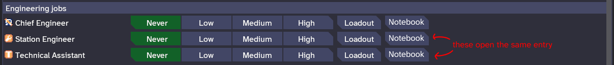
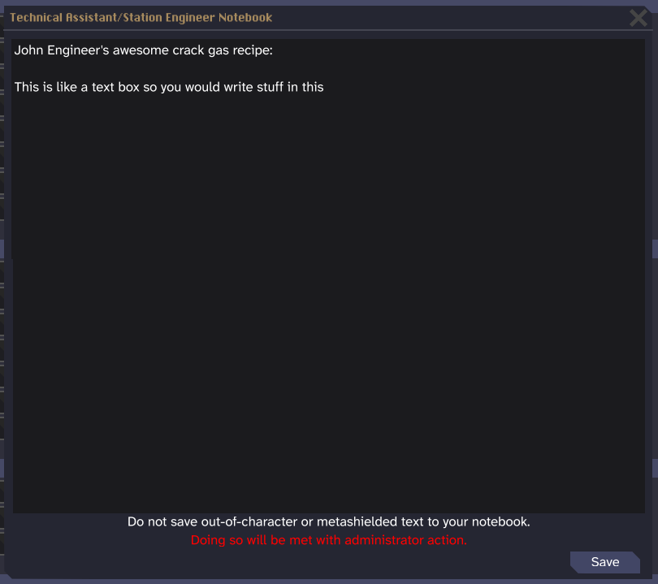

```admonish note
This is the new template for design documents. Many of the currently merged docs use a legacy format. While we won't deny any PRs for using the old format, this version is heavily preferred.
```

# Guidebook Redux

<!-- Your title should convey the basic jist of your proposed changes. It should be short because the text will be linked in the sidebar. -->

| Designers       | Implemented                                                                             | GitHub Links    |
| --------------- | --------------------------------------------------------------------------------------- | --------------- |
| pirakaplant | :x: No | TBD |

<!--`Designers` should be the names that you use on GitHub and/or Discord. This is optional but strongly recommended, since:

- This acknowledges credit where it is due
- People who are confused about the written intent can use this information to contact the authors

`Implemented` is the status of the feature.

Github links can include multiple PRs, if relevant.-->

## I. Summary

<!-- This should be an incredibly short (5 sentences, max) paragraph that summarizes everything else in the document. Emphasis on *short,* this should not be used to introduce any information or add any background information. People should be able to read this section and get the basic idea.

If you're struggling to keep it short, remember that you only really need one sentence here: your thesis statement (yes, I know!). You're ultimately making an argument on how to fix a problem, and why your solution is the best. If you're unsure how to tackle this, come back to this section last, and try writing it in this format: \<Solution> should be implemented in order to address \<problem>, because of \<intent>. -->

This document proposes the separation of the guidebook across both OOC documentation (the existing guidebook) and IC documentation (pamphlets, library books, department codices, posters). It also proposes the addition of a notebook whose content persists between rounds. These changes offload unnecessary information that clutters the guidebook to specialised sources of information, which are immersive and fit how the game thrives at teaching players its mechanics.

## II. Problems

<!-- What is the *overarching* problem that you are seeking to solve? This is sometimes a hard question to answer because features, particularly new ones, aren't fixing an issue in the same way that a bugfix is. It's a more abstract question about the game and design as a whole. Think of the "problem" being less of an apparent issue and more so where the game falls a little short, or could be improved.

If you're struggling to answer identify a problem that relates to your feature, then try to break it down step by step and work backwards. If you're making a new species, then how is your new species unique? What niche is it filling that the other species do not? If you can identify how something is unique, then you can reverse the statement to identify the problem. If you come up with a unique species, then there is a problem where the other species don't fill the same niche,

Another example is redesigning a department, or adding more to them. It's easy to fall into the idea that there should be more content added purely because more content means more playtime. If this is the only problem you can identify, then take a step back and reconsider it. You should be thinking about the ways things fail in order to better understand how to improve them. Something being easy and short to complete can be an issue, but there's usually a larger overarching problem for why it actually feels bad. If it's too easy to complete something, is that because the mechanics are surface level? Do they feel too much like press A to get to point B? Maybe they should be more tactile then. -->

### It's Overwhelming

The first thing a new player sees, after accepting the rules of whatever server they're playing, is a window with a lot of tabs relating to *almost every single thing in the game*. This is needless information overload, especially for that new player. Sorting through information in the guidebook is tedious even for the advanced player, as any given round requires only a fraction of the information all crammed into one popup.

### Immersion, or Lack Thereof

How information about the game is presented affects how one interacts with it. One of *Space Station 14*'s strengths as an immersive roleplaying experience is that a lot of the game's learning is handled entirely in-character. While some things have to be learned out-of-character (such as controls), learning how to do a job is framed as an in-character moment that fits into the overall narrative of the round. The guidebook works against this by presenting all its information in an out-of-character format that can be accessed at any time. Moving the game's documentation to in-character manuals and instructions would greatly improve the immersion here.

The other, more maldy side of the coin are how systems like space law/NTCL are treated as a result of their "OOC-ification". One can check a definition of any law to the letter at *any time*, even as they're being hauled away in cuffs. Lawyers are functionally useless, as everyone already knows their rights. Arguably, putting law and other in-character regulations in the same informational category as server rules and objective information about the game also negatively shapes how people interact with those systems.

On top of this, limiting information is a very useful game design tool that we can use to influence how people think about and interact with in-character knowledge. Even if we can't literally make people forget about metashielded topics (or just anything their character would not have an encyclopedic amount of knowledge on), not including it as information that can be accessed at will passively influences people to act in-character. If there's a higher bar of effort to accessing information, even if that bar is just memorising those things or writing them down, that will still influence behaviour.

## III. Intent

<!-- By proposing this new design, what is your intended outcome? Basically, in the ideal scenario, what do you want to happen? This is important because the way things are implemented may change, even drastically, but we want to have a way to know what the original goal was. This is also where you should be thinking about our [design principles](https://docs.funkystation.org/design/design-principles.html) and how your feature fits into them.

As an example, think about the very first implementation of changeling we had on Funkystation (originally from Goobstation). A lot of people really liked the *idea* of changeling, despite the fact that the antagonist itself didn't really fit the common idea of what it should be. Some people thought changeling should be like the Thing, slowly picking off the entire crew with no one able to stop it. Some thought it should always be stealthy, no one able to even tell there was a changeling in disguise. Some thought it should be a bit more antagonistic, killing some in broad daylight and evading capture. Some thought it should be tragic, a sentient and empathetic person with an unstoppable bloodlust.

With five different *intents,* the whole antagonist was a mess without any real direction. Adding or changing different abilities didn't really solve the issue of it having no real direction, so the entire antagonist had to be axed. Having a clearly stated intent for a feature helps prevent this, and it also means later additions are easier to figure out. -->

Jobs would only be carrying books around if they needed them. Internal Affairs deals with the letter of a lot of complicated in-character rules, so them keeping the relevant books is warranted. Security Officers should probably also keep a copy of Article 2 on them, but in a way that fits their vibe a bit more. Likewise, jobs that rely on detailed recipes (Bartender, Chef, Chemist) should probably have books with that information on their person. Other specialised information would require going to the library, meaning the Librarian would get more visitors and more inter-character interaction.

Interns would be given enough information to feel like they have some idea of what they are doing, but not so much that it completely replaces in-character teaching. Ideally, the two would be intertwined in some way, such as documentation prompting the intern to ask about the specifics of what they are learning.

There would be some kind of "backup" source of advanced information that department heads should be able to break out when needed. However, this would not be handed around freely, and would have some intrinsic reason to be kept within their department (being irreplaceable is a good motivation, containing sensitive information would be a better one where it makes sense).

Players should also have the means to "take notes" in character without having to rewrite those notes every time they start a new shift. This would make working without the guidebook constantly on-hand a bit easier, and add an element of personality to how characters conduct their work (different people have different ways of doing things, and this shows in how they note those things down). This would also bring the character's knowledge into the world as a tangible object that can be looked at, copied off of, et cetera.

## IV. Solution

<!-- The most important section: what are you doing? What feature is being made or changed? Give a general overview of what you're adding or changing, primarily focusing on the critical design points. Someone should be able to read this and be able to directly implement your design based on the points you discuss.

Do NOT put literal numbers or focus on "game balance" here. Balance can be changed on a whim, and isn't a real indicator of if something is fun. Honestly, balance is a lot more subjective than you think. It's not a good way to tell if something is good or bad. Something can be completely unbalanced and still be "good" because it serves a different purpose. Don't focus on balance. -->

All guidebook entries will be rewritten to match Funky's current content. They should follow structure and typography that's internally consistent (for example, all department entries should have their sections ordered and worded in a similar way).

### The Guidebook Proper

The guidebook itself will be stripped down to a minimal amount of information written from an out-of-character perspective. This would include:

- Basic information on *Space Station 14*.
	+ This would include the premise, the controls, how to make a character, and the like.
- Basic information on Funky specifically, such as major changes from most other *Space Station 14* forks.
- Information on species.
- A surface-level description of each department and its personnel.

### SOP Posters

Each department has at least one departmental SOP poster in an easy-to-find location within the bounds of the department, such as near the front desk or in a breakroom. The exception is Internal Affairs, since they'll all have the entirety of Article 3 in book form (see "Reference Books" below).

Generic SOP posters that contain the SOP for general crew and Civilians can be found in hallways.

These posters, when inspected, have a guidebook link to the relevant section of SOP.

### Reference Books

Reference books cover the specifics on how a specific subset of the game works. Articles in these books are written from an in-character perspective.

The scope of each book should be limited to a specific topic. Rather than having the "science book" and the "engineering book", there would be separate books for scientific research, robotics, engine maintenance, construction, atmospherics, etc.

One copy of each reference book can be found in the library. Some areas start with their own reference books:

- The Captain's office, XO's office, and the Internal Affairs lobby all have a shelf with each NTCL article inside mapped.
- The Commandant's, Warden's, and Magistrate's offices would each have a shelf with NTCL articles 2 and 5 mapped.
- Internal Affairs Agents' lockers contain a copy of NTCL article 3.
- Both regular Security and Lieutenant lockers contain a copy of NTCL article 2 (ideally a variant resprited as a shitty mini paperback copy). 
- The Bar has a mixology book (which would contain the reference pages for beverages) mapped.
- The Chemistry Lab has a chemical encyclopedia (which would contain the reference pages for non-beverage reagents) mapped.
- The Kitchen has a cookbook (which would contain the reference pages for food) mapped.

### Department Codices

Each department (not counting Command) has a department codex in the head's locker. This codex contains information relevant to all aspects of the department, though NTCL information should be in separate books. Department-specific corporate secrets would also go in here.

### Pamphlets

All intern jobs start with a pamphlet corresponding to their job. Cargo Technicians and all Service (besides the Hospitality Director) and Civilian jobs start with a pamphlet corresponding to their job if they have less than six hours of playtime in that job.

A job's pamphlet contains the following information, written from an in-character perspective:

- A foreword about NanoTrasen as a company. Make sure it's evil as fuck but couched in corporate coloniser language.
- A "who's who" of their department's jobs. (i.e. "this is the Chemist, you should go to them for medicine".)
- A basic overview of the job's duties and enough information to get started on them. (Ideally, this should encourage them to ask for help where feasible rather than just giving them all the answers.) 

### Notebooks

Each job has a notebook as an optional starting item. This notebook can be written in with a pen, similar to a sheet of paper. However, unlike paper, notebooks are persistent between rounds, with some caveats. Stamps do not persist between rounds, and tags like `[check]`, `[form]`, and `[signature]` do not keep any information put into them.

At the end of the shift, if the player's character is still alive, they will be prompted, asking them if they want their notes to be saved. This prompt comes with a warning not to save any notebook information that has metaknowledge, and that doing so can be punished with administrator action.

Each job, per character, has its notes saved separately (with interns sharing notes with their non-intern equivalents). The notes can be reviewed and edited in the character customisation menu, with similar warnings regarding metaknowledge.

## V. Considerations

<!-- There are three main considerations you need to address: technical, admin, and player. Some features need lots of considerations, some don't need really any, and sometimes some considerations just aren't applicable. Use your discretion to understand which are necessary for your feature.

Technical considerations refer to any type of code or systems necessary to accomplish this feature. Do you need to refactor any systems to make your feature possible? Or maybe code something from the ground up? Make note of anything that might be important to know for implementing or maintaining your feature (for example, database changes, refactoring WizDen content, engine changes, etc).

Admin considerations refer to any rule changes or overhead that you need to keep track of. If your feature might need a rule to be changed to work, you need to keep note of that. You should also keep track of if any features you add might need extra admin tooling, or if admins should keep something in mind once your design is done. Consider the ways that your feature might increase admin burdens and how you can potentially mitigate that.

Player considerations can either be about culture concerns or accessibility issues. For example, if a feature has any visual additions, then you might want to detail how it might add flashing lights, migraine-inducing noise, color contrast concerns, etc. You would also want to plan on how to make those issues more accessible (such as toggles) here. Culture concerns are a bit of a vague catch-all. Your design should try and encourage the player behavior you want, but sometimes individual features need more support in order to actually encourage certain behavior. If you're concerned about players doing the exact opposite of what you are trying to encourage, then detail that here and consider potential solutions. -->

### Technical Considerations

Currently, guidebook entries are all "parented" to the game's OOC guidebook. This means that if a guidebook entry is added at all, it shows up in that guidebook. The guidebook code needs to be rewritten to entries can be assigned to particular "books" (which would include the OOC guidebook in addition to IC items that bring up guidebook entries), and only show up if they're in that book.

The notebooks would also require new code that checks their contents at the end of the round, filters it, prompts the player on whether to save it (which would require minor UI work), and saves it to the server under a per-job field in the character's data. Both UI work and code would also be needed to allow editing notebooks in the character customisation menu.

### Admin Considerations

The notebook would unfortunately add another thing that admins would need to keep track of. There would need to be admin tools for easily checking a player's notebooks to make sure they follow the rules. A system that flags certain metashielded/OOC terms and alerts admins to them would also be useful.

### Player Considerations

There is the possibility that players are given too much or too little information via the methods detailed in this document, which would negatively impact the player experience. Details about this should be recorded in playtesting and the amount of information present from certain sources adjusted as needed.

## Appendix: User Interfaces

Here are some mockups for how the notebook would be edited from the customisation menu:



